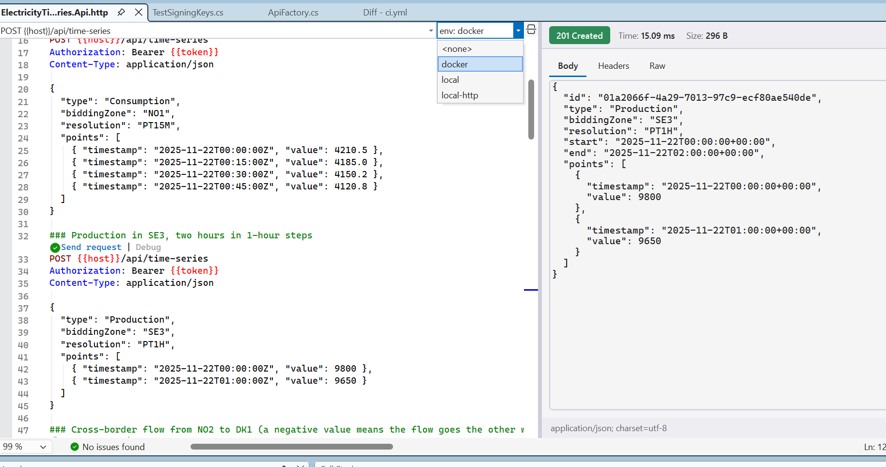

# Electricity Market Time Series API

A small REST API in C# and ASP.NET Core for electricity market time series: production, consumption and cross-border flows between bidding zones. It creates, reads, updates and deletes series, and searches them by bidding zone, type and time interval.

## What you need

- The [.NET 11 SDK](https://dotnet.microsoft.com/download/dotnet/11.0), 11.0.100 or later. `dotnet --version` shows which one you have.
- Visual Studio 2026, up to date, with the **ASP.NET and web development** workload.

- Optionally, [Docker Desktop](https://www.docker.com/products/docker-desktop/) on an x64 (Intel or AMD) processor, to run the API on SQL Server with the Aspire dashboard for its logs, traces and metrics.

Without Docker, the API keeps its data in memory.

## Run it from Visual Studio

1. Clone the repository and open `ElectricityTimeSeries.slnx`.

2. Store a development token, once. Open a terminal at the repository root (**View → Terminal**) and run:

   ```powershell
   ./scripts/New-DevToken.ps1
   ```

   It creates the token with `dotnet user-jwts`, which comes with the SDK, and keeps it in your user secrets, outside the repository. If PowerShell refuses to run scripts, use `powershell -ExecutionPolicy Bypass -File .\scripts\New-DevToken.ps1` instead.

3. Pick the **https** launch profile next to the Run button and press **F5**. The first time, Visual Studio offers to trust its HTTPS development certificate, and then Windows asks to install it: say **Yes** to both. If you said no or never saw the prompts, run this, then restart the API:

   ```powershell
   dotnet dev-certs https --trust
   ```

4. Open `src/ElectricityTimeSeries.Api/ElectricityTimeSeries.Api.http`, pick the **local** environment at the top right, and click **Send request** above any request. There's one for every endpoint and for the common errors. Here a new production series has just come back as `201 Created`; the environment list shows `local` next to `docker`:

   

5. Run the tests from **Test Explorer**, or with `dotnet test` in the terminal. They use in-memory storage, so Docker isn't needed.

## Run it in Docker, on SQL Server

Docker is only used for SQL Server. One script starts the API, SQL Server and the dashboard, and waits until the API answers:

```powershell
# -Fresh starts SQL Server empty
./scripts/Start-SqlServer.ps1
```

If PowerShell refuses to run scripts, start it the same way as in step 2. Then:

- The API is at `http://localhost:5020`. In the `.http` file, pick the **docker** environment; the token from step 2 works here too.
- The [Aspire dashboard](DOCS.md#logs-traces-and-metrics) at `http://localhost:18888` shows the API's and SQL Server's logs, traces and metrics.
- The data survives restarts. You can connect to SQL Server at `localhost,14330`, user `sa`, password `Local-dev-1`.
- `$env:TEST_STORAGE = "SqlServer"; dotnet test` runs the integration tests on SQL Server. They start their own SQL Server container, so only Docker needs to be running.

To stop: `docker compose down --remove-orphans`.

## The endpoints

Every endpoint needs the token from step 2.

| Request | What it does |
|---|---|
| `POST /api/time-series` | Creates a series |
| `GET /api/time-series/{id}` | Gets one series |
| `GET /api/time-series?biddingZone=NO1&type=Consumption&from=…&to=…&skip=0&take=1000` | Searches; every filter is optional, only the points between `from` and `to` come back, up to 1000 points per page (`X-Total-Count` has the total) |
| `PUT /api/time-series/{id}` | Replaces a series |
| `DELETE /api/time-series/{id}` | Deletes a series |

## Everything else

[DOCS.md](DOCS.md) has the details:

- [Architecture and design choices](DOCS.md#architecture)
- [Assumptions](DOCS.md#assumptions)
- [The data model, search and validation rules](DOCS.md#api)
- [Security: tokens, scopes and emergency revocation](DOCS.md#security)
- [Testing](DOCS.md#testing) and [continuous integration](DOCS.md#continuous-integration)
- [More on running it: SQL Server, Docker and the Aspire dashboard](DOCS.md#running-the-api)
