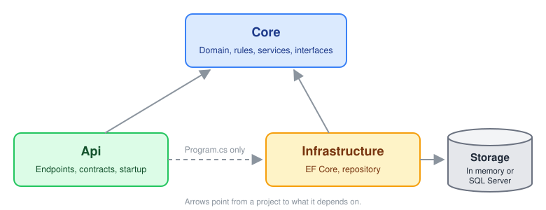

# Electricity Market Time Series API

A small REST API built with C# and ASP.NET Core for managing electricity market time series data, such as production, consumption and cross-border flows between bidding zones.

> **Status:** the CRUD endpoints, filtering, validation, authentication and authorization, telemetry, tests and CI are in place. Data is stored through EF Core, in memory (the default) or in SQL Server; the integration tests run against both.

## Requirements

- [.NET 11 SDK](https://dotnet.microsoft.com/download) (`global.json` requires 11.0.100 or any later 11.0 SDK)
- [Docker](https://www.docker.com/) with Docker Compose, optional: for running the API in a container, and for running the integration tests against SQL Server

## Running the API

```powershell
dotnet run --project src/ElectricityTimeSeries.Api --launch-profile https
```

The API listens on `https://localhost:7244` and `http://localhost:5021`. In Visual Studio, select the `https` or `http` launch profile.

Each way of running the API has its own port, so they can all run at the same time:

| How it's started | Address |
|---|---|
| `dotnet run`, or the `http` / `https` launch profile | `http://localhost:5021`, `https://localhost:7244` |
| `docker compose up` | `http://localhost:5020` |
| Visual Studio's `Container (Dockerfile)` launch profile | `http://localhost:5022` |

The same `dotnet user-jwts` tokens work with `dotnet run` and `docker compose`.

### Running in Docker

`docker-compose.yml` runs the API in a container, in the `Development` environment with in-memory storage, at `http://localhost:5020`:

```powershell
docker compose up --detach --build
docker compose down
```

The container uses the same tokens as `dotnet run`: the host's user secrets folder, which holds the `dotnet user-jwts` signing key, is mounted read-only into the container. On Windows this works as is. On Linux or macOS, set `USER_SECRETS_PATH=~/.microsoft/usersecrets` first.

In Visual Studio, the `Container (Dockerfile)` launch profile builds the same `Dockerfile` and runs it at `http://localhost:5022`.

### Using SQL Server

Data is kept in memory unless configured otherwise. To use SQL Server, set `Storage:Provider` to `SqlServer` and `Storage:ConnectionString` to its connection string, for example as the environment variables `Storage__Provider` and `Storage__ConnectionString`. The API doesn't create or update the tables itself, so apply the migrations once, and again after pulling new ones:

```powershell
dotnet tool restore
dotnet ef database update --project src/ElectricityTimeSeries.Infrastructure --startup-project src/ElectricityTimeSeries.Infrastructure --connection "<connection string>"
```

### OpenAPI and health

In the Development environment, the OpenAPI document is served at `/openapi/v1.json`. A health endpoint is available at `/health`. Both are anonymous; every other endpoint requires a bearer token (see below).

### Getting a token for local development

The API uses JWT bearer tokens. Locally, tokens are issued by the [`dotnet user-jwts`](https://learn.microsoft.com/aspnet/core/security/authentication/jwt-authn) tool that ships with the .NET SDK, so no identity server is needed. The signing key is stored in your user secrets and the matching issuer/audience settings are already in `appsettings.Development.json`.

```powershell
# Token with full access (read + write)
dotnet user-jwts create --project src/ElectricityTimeSeries.Api --name dev-user --scope TimeSeries.Read --scope TimeSeries.Write

# Read-only token
dotnet user-jwts create --project src/ElectricityTimeSeries.Api --name reader --scope TimeSeries.Read
```

Send the printed token in the `Authorization` header:

```
Authorization: Bearer <token>
```

User secrets are per machine, so each developer runs the commands above once after cloning.

### Trying the API from Visual Studio

`src/ElectricityTimeSeries.Api/ElectricityTimeSeries.Api.http` has a request for every endpoint and the common errors. Its environments (`local` for the `https` launch profile, `local-http` for the `http` one, `docker` for `docker compose`) are in `http-client.env.json` and read the token from your user secrets, so nothing secret is committed. Store a token there once:

```powershell
./scripts/New-DevToken.ps1
```

Then pick the environment above the `.http` file and send requests. Tokens last about three months (or pass `-ValidFor 365d`); run the script again when requests start returning `401`. It prints when the new token expires.

### Logs, traces and metrics

The API sends its logs, traces and metrics through OpenTelemetry, but only when `OTEL_EXPORTER_OTLP_ENDPOINT` is set. Locally they go to the Aspire dashboard, which runs as a container:

- `docker compose up` starts the dashboard next to the API. Open `http://localhost:18888`; there's no login, since it only listens on this machine.
- `dotnet run`, F5 and the `Container (Dockerfile)` profile send to the same dashboard. To start only the dashboard: `docker compose up dashboard --detach`.
- If the dashboard isn't running, nothing breaks; the telemetry is just dropped.
- A trace shows the request, the service and repository calls inside it, and each save; on SQL Server, the SQL calls too. Every request is traced, even when the caller asks not to (Visual Studio's HTTP client does). `/health` calls are left out.
- In Development, metrics go out every 5 seconds (`OTEL_METRIC_EXPORT_INTERVAL`), instead of every minute.
- The tests and CI send nothing. One integration test (`TelemetryTests`) catches the API's traces in memory, to make sure they keep being produced.
- Sending it somewhere else later (Grafana, Azure Monitor, …) is a settings change: point `OTEL_EXPORTER_OTLP_ENDPOINT` there.

## API

| Method | URL | Scope | Result |
|---|---|---|---|
| `GET` | `/api/time-series?biddingZone=&type=&from=&to=` | `TimeSeries.Read` | `200` with the matching series |
| `GET` | `/api/time-series/{id}` | `TimeSeries.Read` | `200`, or `404` |
| `POST` | `/api/time-series` | `TimeSeries.Write` | `201` with a `Location` header |
| `PUT` | `/api/time-series/{id}` | `TimeSeries.Write` | `200` with the replaced series, `404`, or `409` if changed at the same moment by another request |
| `DELETE` | `/api/time-series/{id}` | `TimeSeries.Write` | `204`, `404`, or `409` if changed at the same moment by another request |

Example body for `POST` and `PUT`:

```json
{
  "type": "CrossBorderFlow",
  "biddingZone": "NO2",
  "toBiddingZone": "DK1",
  "resolution": "PT15M",
  "points": [
    { "timestamp": "2025-11-22T00:00:00Z", "value": 1250.5 },
    { "timestamp": "2025-11-22T00:15:00Z", "value": 1190.0 }
  ]
}
```

### Data model

A **time series** is a block of evenly spaced values for one bidding zone, for example "consumption in NO1 on 22 November, every 15 minutes". This matches how market data is usually exchanged: a whole block is sent, replaced or removed at once.

| Field | Meaning |
|---|---|
| `type` | `Production`, `Consumption` or `CrossBorderFlow` |
| `biddingZone` | The zone, for example `NO1`. For a flow, the zone the electricity leaves. |
| `toBiddingZone` | For a flow only: the zone the electricity goes to |
| `resolution` | How long each value lasts, as an ISO 8601 duration: `PT15M` or `PT1H` |
| `points` | The values. Each covers the period from its `timestamp` to `timestamp` + `resolution`. |
| `start`, `end` | Returned by the API: when the first point starts and the last point ends |

Responses leave out empty fields, so production and consumption series have no `toBiddingZone`.

### Searching

- `biddingZone` matches series in that zone, and flows into or out of it.
- `from` (inclusive) and `to` (exclusive) return the series that have data in that interval, with **only the points inside it**. A point that partly overlaps the interval is included.
- All filters are optional and can be combined. Send times with a time zone (`Z` or an offset such as `%2B01:00`, where `%2B` is a URL-encoded `+`); see [Assumptions](#assumptions) for times without one.

### Validation

Requests that break a rule return `400 Bad Request` with the list of invalid fields, in the Problem Details format. The rules:

- Missing or `null` fields are reported by name, all at once, for example `resolution` or `points[0].value`. A wrong value type (text where a number is expected) is reported on the field itself, for example `$.points[0].timestamp`.
- `type` is read first, because it decides which fields are expected. A missing or unknown `type` is reported on the whole object (`$`). Its values are case-sensitive: `Consumption`, not `consumption`.
- Only `CrossBorderFlow` takes a `toBiddingZone`; for the other types it's rejected as an unknown field (`$.toBiddingZone`).
- The bidding zones must be known (see [Assumptions](#assumptions)). A flow needs a different receiving zone; other types can't have one.
- The resolution must be 15 minutes or 1 hour.
- There must be between 1 and 35,136 points (one year of 15-minute values).
- Each point must start on a resolution boundary (for example 10:15, not 10:07) and follow the previous one by exactly one step: no gaps, duplicates or reordering.
- Production and consumption can't be negative. Flows can, as a negative value means the electricity flows the other way.
- Values have at most 6 decimal places (watt-level precision for MW) and lie between ±9,999,999,999,999.999999, the range SQL Server stores exactly (`decimal(19,6)`). The same rule applies to in-memory storage, so both behave alike.
- In a search, `from` must be earlier than `to`.

## Solution structure

```
ElectricityTimeSeries/
├── ElectricityTimeSeries.slnx
├── global.json                                SDK version (11.0, any later feature band)
├── Directory.Build.props                      Settings shared by all projects (target framework, nullable, implicit usings)
├── Directory.Build.targets                    Shared build steps (empty for now)
├── Directory.Packages.props                   Every package version, in one place
├── NuGet.config                               Package sources: nuget.org only
├── .editorconfig                              Code style
├── dotnet-tools.json                          Local tools: dotnet-ef, for migrations
├── Dockerfile                                 API container image
├── docker-compose.yml                         API in a container, for local development
├── azure-pipelines.yml                        Azure DevOps pipeline
├── .github/workflows/ci.yml                   GitHub Actions pipeline
├── scripts/New-DevToken.ps1                   Stores a development token for the .http file
├── docs/architecture.svg                      The architecture diagram below
├── src/
│   ├── ElectricityTimeSeries.Api/             Presentation: controllers, request/response contracts, startup wiring
│   ├── ElectricityTimeSeries.Core/            Domain + application: entities, business rules, services, abstractions
│   └── ElectricityTimeSeries.Infrastructure/  Data access: storage and repository implementations
└── tests/
    ├── ElectricityTimeSeries.UnitTests/               Isolated logic: business rules, authorization handler
    └── ElectricityTimeSeries.Api.IntegrationTests/    The whole API, run inside the test process on in-memory storage or SQL Server
```

## Architecture

The solution follows **Clean Architecture** principles, built on the **Dependency Inversion Principle**: source code dependencies point inward, towards the business logic.



| Project | Responsibility | Depends on |
|---|---|---|
| **Core** | Domain entities, business rules, validation, application services, and the interfaces it needs from the outside world (for example `ITimeSeriesRepository`) | nothing |
| **Infrastructure** | Implements the Core interfaces against a concrete storage technology | Core |
| **Api** | HTTP endpoints, request/response contracts, error handling, and composing the application at startup | Core, Infrastructure (startup wiring only) |

### Key design decisions

- **Core owns the abstractions.** Core defines what it needs (for example a repository interface), and Infrastructure provides it. Business logic has no knowledge of how or where data is stored, so it can be unit tested without a database, and the storage technology can be replaced without touching Core or the API.
- **The API does not know about storage.** Controllers depend only on Core services and types. Apart from the generated migration, all Infrastructure types are `internal`; the public ones are `AddInfrastructure(configuration)`, `InitializeStorageAsync()` (applies migrations) and the `StorageOptions` settings. Api references Infrastructure solely so that `Program.cs` can act as the *composition root*, the single place where implementations are wired to abstractions. The compiler prevents any other use.
- **Each layer registers its own services** through an extension method (`AddCore()`, `AddInfrastructure()`), which keeps `Program.cs` short and keeps each layer's internals private.
- **API contracts are separate from domain entities.** Request and response classes live in the Api project, so the public HTTP contract can change independently of the domain model and the storage model.
- **Consistent error responses.** Errors are returned as RFC 9457 Problem Details (`AddProblemDetails`, `UseExceptionHandler`, `UseStatusCodePages`).
- **Authentication and authorization live in the Api layer.** They are HTTP concerns, so Core and Infrastructure stay unaware of them (see [Security](#security)).
- **The domain class is also the stored class.** There are two sets of classes, not three: request/response classes in Api, and domain classes in Core. EF Core saves the domain classes directly, and how they map to storage is described in Infrastructure (`TimeSeriesConfiguration`), so Core has no storage code. The only concession is a private constructor and private setters that EF Core uses when loading data.
- **The domain enforces its own rules.** A `TimeSeries` can only be created or changed through `Create` and `Update`, which check every business rule, so an invalid series can't exist. A broken rule throws `DomainValidationException`, which the Api turns into a `400` response.
- **One shape per kind of time series.** `TimeSeriesDefinition` is a C# 15 union of `ProductionDefinition`, `ConsumptionDefinition` and `CrossBorderFlowDefinition`. Only a flow has a receiving zone, so a flow without one, or consumption with one, can't even be written in code. Every `switch` over the union must handle all three kinds, so adding a kind makes the compiler point at each place to update.
- **The request is a closed hierarchy, not a union.** `TimeSeriesRequest` is a C# 15 `closed` class with exactly three subclasses: `ProductionRequest`, `ConsumptionRequest` and `CrossBorderFlowRequest`. Like a union, a `switch` over it must cover all three. Unlike a union, System.Text.Json reads and writes the `type` field by itself (`[JsonPolymorphic]` with `[JsonDerivedType]`), which is what Microsoft recommends for JSON objects told apart by a field; unions are for cases that differ in shape. The OpenAPI document shows the three kinds with a proper discriminator. Request fields are nullable and marked `[Required]`, so ASP.NET Core reports every missing or `null` field by name, all at once. They're nullable on purpose: `[Required]` only checks for `null`, so on a plain struct a missing point `value` would quietly become 0 and pass. Two settings make it fit: `AllowOutOfOrderMetadataProperties` lets `type` appear anywhere in the object, and `MissingTypeJsonInputFormatter` turns a missing `type` into a `400` (System.Text.Json reports it as a non-JSON error, which ASP.NET Core would otherwise answer with a `500`).
- **EF Core, in memory or in SQL Server.** The `Storage` configuration section picks the storage: `Provider` is `InMemory` (the default, which the assignment allows) or `SqlServer`, with a `ConnectionString`. The choice lives entirely in Infrastructure (`AddInfrastructure`); nothing else knows which one is used. SQL Server tables come from EF Core migrations (`Persistence/Migrations`). The integration tests apply them through `InitializeStorageAsync`; for a real database, use `dotnet ef database update` (see [Using SQL Server](#using-sql-server)). To add a migration: `dotnet tool restore`, then `dotnet ef migrations add <Name> --project src/ElectricityTimeSeries.Infrastructure --startup-project src/ElectricityTimeSeries.Infrastructure --output-dir Persistence/Migrations`.
- **Simplified layering.** A full Clean Architecture template usually splits Core into separate Domain and Application projects. Given the scope of this API, they are merged into a single Core project, which keeps the solution easy to navigate while preserving the dependency rule.

## Security

**Authentication** uses JWT bearer tokens (`Microsoft.AspNetCore.Authentication.JwtBearer`). The API validates each token's signature, issuer, audience and lifetime. Bearer options are bound from the `Authentication:Schemes:Bearer` configuration section, so moving from `dotnet user-jwts` to a real identity provider (Microsoft Entra ID, Keycloak, Auth0, …) is a configuration change only: set `Authority` and `ValidAudiences` for that provider.

**Authorization** is policy-based, driven by scopes in the token:

| Policy | Required scope | Applies to |
|---|---|---|
| `CanReadTimeSeries` | `TimeSeries.Read` | `GET` endpoints |
| `CanWriteTimeSeries` | `TimeSeries.Write` | `POST`, `PUT`, `DELETE` endpoints |

- **Scopes and policies are separate concepts.** Scopes (`Scopes`) are the identity provider's contract: the exact values issued in tokens. Policies (`Policies`) are the API's own authorization rules, which controllers reference with `[Authorize(Policy = ...)]`. A policy can later combine several requirements (for example a scope plus a role), or follow a renamed scope, without touching any controller.
- **Scope checks use a requirement and a handler**, the same pattern as the framework's built-in checks: `ScopeRequirement` states which scope is needed, and `ScopeAuthorizationHandler` (resolved from DI) evaluates it. The rule is defined once, reused by every policy, and unit testable without hosting the API.
- Read and write are separate because most consumers of market data (monitoring, analysis) only read, while only data-producing systems should change it. A token needs both scopes for full access.
- A **fallback policy** requires an authenticated caller on every endpoint by default. Anonymous endpoints (`/health`, the OpenAPI document) must opt out explicitly, so a new endpoint can't be exposed by accident.
- Scopes are read from the `scope` claim (OAuth 2.0 standard, used by `dotnet user-jwts`) and the `scp` claim (Microsoft Entra ID), including space-separated values.
- A missing or invalid token returns `401 Unauthorized`; a valid token without the required scope returns `403 Forbidden`. Both use the Problem Details format.

## Testing

The tests are split into two levels. By default neither needs Docker, an identity provider or any local setup. Both use xUnit 3 on Microsoft.Testing.Platform (set in `global.json`).

| Level | What it runs against | Tokens |
|---|---|---|
| **Unit** | Isolated classes: the time series rules, `BiddingZone`, `HasScope()`, `ScopeAuthorizationHandler` | none |
| **Integration** | The whole API, run inside the test process with `WebApplicationFactory` and called through HTTP requests (no network), on in-memory storage or SQL Server | signed by the test project with its own key pair |

```powershell
dotnet test
```

### Integration tests

- The API runs in a dedicated `Testing` environment, so user secrets and `appsettings.Development.json` are never loaded. The tests behave the same on every machine and in CI.
- The API is set up **as it is delivered**: it trusts an identity provider (`Authority` plus audience) and downloads that provider's public keys when it needs them. The only test-specific setting is where those downloads go: `FakeIdentityProvider`, which answers them inside the test process.
- Each test's API gets its own **public/private key pair** (`TestSigningKeys`), created in memory and gone when the test ends, so CI needs no keys or secrets. `TestTokenFactory` signs tokens with the private key; the API only ever sees the public key, published by the fake identity provider in the same format Keycloak or Entra ID use. Nothing secret is shared between the tests and the API.
- Requests go through the API's real token checks, so the tests also cover expired, wrongly addressed, wrongly signed and tampered tokens, and the trick of signing with the public key as if it were a password.
- The time series endpoints are tested with raw JSON requests, so the tests also pin down the public JSON format: field names, type names and `PT15M` durations. They cover each operation, searching, every validation rule, `404` for unknown ids, and that each endpoint needs the right scope.
- Each test gets its own API instance and starts on empty storage that no other test is using (`IsolatedApiTest`). So every test is repeatable, can check exact results ("the search returns exactly these two"), and runs in any order or in parallel. Tests that don't need a clean slate can share one API and database explicitly (`SharedApiFixture`); the authorization tests do, since they store nothing.
- Authorization is tested through test-only endpoints (`AuthorizationProbeController`) that use the real policies. They are added only inside the test host and never ship with the API.
- Telemetry is checked by catching the API's traces in memory (`TelemetryTests`), down to the save of a new series. A test request carries its own trace id, so it can't be confused with other tests' requests.

### Storage: in memory or SQL Server

The integration tests run against either storage, chosen with the `TEST_STORAGE` environment variable:

```powershell
dotnet test                                   # in-memory storage (default)
$env:TEST_STORAGE = "SqlServer"; dotnet test  # SQL Server in Docker
```

With `SqlServer`, the tests start one SQL Server container themselves through [Testcontainers](https://dotnet.testcontainers.org/) and remove it when the run ends, so only Docker needs to be running. Starting SQL Server is the slow part, so the one server is shared by the whole run; isolation comes from giving every test an empty database inside it that no other test is using. Creating and migrating a database takes seconds, so they are pooled: a test borrows one, and afterwards its tables are emptied and it goes back to the pool (or is dropped, if emptying fails). Only as many databases are created as tests run at the same time.

`ConcurrencyTests` fire requests at the same series in parallel, which matters most against SQL Server: parallel deletes give one `204` and otherwise `404`, parallel updates leave exactly one complete version (never a mix), and a write that loses a race gets `409 Conflict` instead of failing.

**Not covered by the integration tests:** the network connection to a real identity provider (its address, HTTPS, and the provider's own setup).

### Continuous integration

Two equivalent pipelines restore and build in Release, run the unit tests, run the integration tests twice (in-memory storage, then SQL Server in Docker), and publish the test results:

- **Azure DevOps:** `azure-pipelines.yml`, on a Microsoft-hosted Ubuntu agent. Results appear in the run's Tests tab.
- **GitHub Actions:** `.github/workflows/ci.yml`, on every push to `main` and every pull request. Results appear on the run's summary page, built from xUnit's Markdown reports, with details of any failed test.

## Assumptions

- Access is granted per scope (read/write) for all time series. Finer-grained rules, such as restricting a client to specific bidding zones, are out of scope.
- **Bidding zones:** the Nordic zones (`NO1`–`NO5`, `SE1`–`SE4`, `FI`, `DK1`, `DK2`) and the neighbouring zones they trade with (`EE`, `LV`, `LT`, `PL`, `DE-LU`, `NL`, `GB`). Codes are case-insensitive and stored in upper case.
- **Units:** all values are in MW, the average power over each point's period.
- **Resolution:** 15 minutes (the Nordic market time unit since 2025) or 1 hour (older data).
- **Time zones:** clients may send any offset; times are stored and returned in UTC. A time sent without an offset is read as the server's local time (UTC in the Docker container), so clients should always send one.
- **Overlaps are allowed:** several series may cover the same zone, type and time. The API doesn't decide which one is correct.
- **Simultaneous changes:** when two requests change or delete the same series at the same moment, one is saved and the other gets `409 Conflict` (get the series again and retry); a change is never half-applied. Each series has a hidden version stamp for this, kept in storage only. There is no `ETag` / `If-Match` yet, so a client that read a series earlier and saves later still overwrites changes made in between.
- **No paging:** a search returns every match. Clients are expected to narrow it with filters.
- **With in-memory storage, data is lost on restart.**
